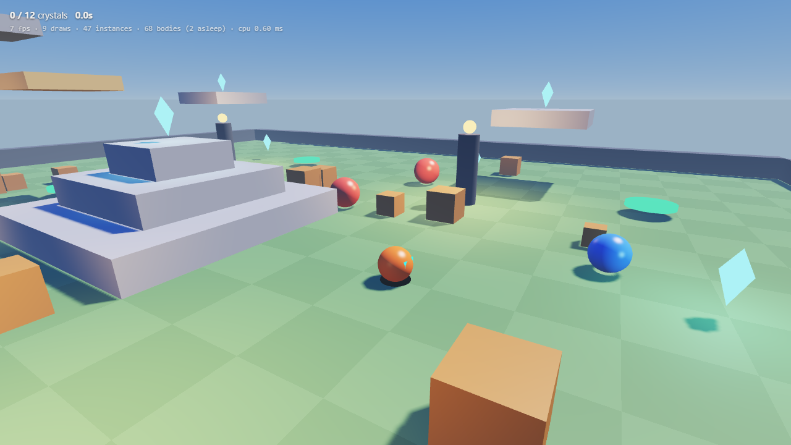

# ember

A small 3D game engine for the browser, written in TypeScript on WebGL2 with no dependencies. It comes with a playable demo, **Crystal Run**.



```bash
npm start            # builds, then serves http://127.0.0.1:8080/web/
npm test             # 34 tests (math, ECS, physics, meshes, loop, particles)
npm run bench        # physics and ECS benchmarks
```

Needs Node 23.6 or newer (it runs TypeScript directly with type stripping). Nothing to install.

Controls: `WASD` move, `Space` jump (hold for height), `Shift` run, mouse or `Q` `E` to look, `R` restart. Green pads launch you. A gamepad works too.

## What's in it

| module | what it does |
|---|---|
| `src/renderer.ts` | Instanced WebGL2 forward renderer. Every mesh draws in one call per pass. Sun with a 2048² PCF shadow map, hemisphere ambient, up to 8 point lights, height fog, ACES tonemapping, procedural sky, frustum culling. |
| `src/physics.ts` | Spheres and boxes (no rotation). Grid broadphase, impulse contacts with restitution and Coulomb friction, shock propagation for stacks, sleeping, triggers, collision layers, raycasts. |
| `src/ecs.ts` | Sparse-set ECS with generational entity handles and deferred destroy. |
| `src/loop.ts` | Fixed 60 Hz timestep with render interpolation and a stall guard. |
| `src/mesh.ts` | Box, sphere, plane, cylinder and gem generators, plus a signed-volume check. |
| `src/particles.ts` | Fixed-capacity particle pool with no allocation after startup. |
| `src/input.ts`, `src/audio.ts` | Keyboard, mouse with pointer lock, gamepad. Sound effects synthesized with Web Audio, no audio files. |
| `web/game.ts` | The demo game, about 300 lines on top of the engine. |

## Numbers

Physics step, `npm run bench`, Windows 11, Node 24, single thread. Mixed spheres and boxes dropped onto a floor:

| bodies | while falling | settled | asleep |
|---:|---:|---:|---:|
| 100 | 0.92 ms | 0.16 ms | 88 |
| 500 | 2.17 ms | 0.64 ms | 455 |
| 1000 | 4.96 ms | 1.94 ms | 864 |
| 2000 | 9.61 ms | 4.66 ms | 1660 |

ECS: a two-component query over 100k entities (50k matches) takes 5.9 ms.

The demo scene has 68 bodies and 12 crystal lights. It renders in 9 draw calls, and its CPU cost is under 1 ms per frame.

## Things that broke on the way

- **Stacks sank.** Five boxes stacked on the floor slowly sank about 5 cm, and the bottom ones never slept. Plain iterative impulses spread support up a stack too slowly. Fixed by sorting contacts bottom-up and adding a final shock-propagation pass that treats the lower body as immovable. The stack test now checks heights to within 5 cm, and that all five boxes fall asleep.
- **Washed-out colours.** Colours were authored as screen values but lit as linear light, then gamma-corrected a second time. Everything came out pale. Colours are now converted to linear in the shader before lighting.
- **Parameter properties.** Node's type stripping rejects `constructor(readonly x)`. Those are now plain fields.

## Limits

- **Bodies don't rotate.** Boxes stay axis-aligned, which suits characters and crates but not tumbling debris.
- **One shadow cascade,** covering about 70 m around the camera. Distant objects don't cast shadows.
- **Point lights don't cast shadows.**
- **No asset loading yet.** All geometry is procedural; glTF loading is the next thing to add.
